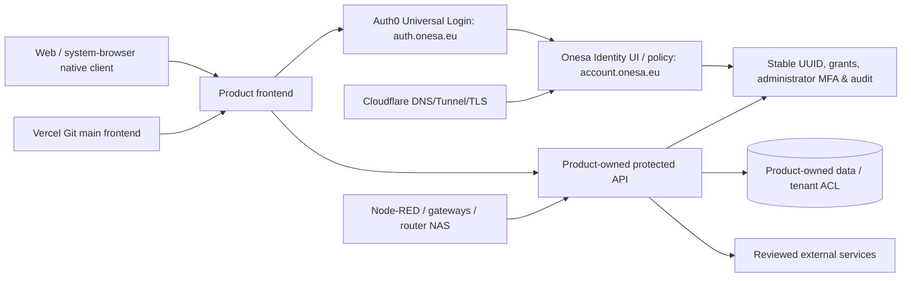

# ARCHITECTURE — controlled, partially verified cross-product map

**Status:** architecture contract assembled from repository documentation, production DNS/tunnel readback and Vercel deployment metadata on 20 November 2026. The diagram is an **intended trust/flow model**, not independently executed full-system topology or working integration proof.

## Trust responsibilities

1. **Auth0 issuer** `https://auth.onesa.eu/` owns credentials, email verification, MFA, recovery, token signing and OIDC session. Current DNS correctly remains provider-owned / DNS-only.
2. **Onesa Account** `https://account.onesa.eu` is a separate application served through Cloudflare Tunnel to the Oracle environment; its source owns stable Onesa user IDs, registration returns, invitations, approvals, suspension, centralized product grants and audit. Tunnel configuration is verified, but runtime `/readyz` and actual Auth0 Account client/Actions are **NOT TESTED** here.
3. **Product APIs** own roles, tenants, farms/sites, documents, orders, business assets, paid entitlements, robotics/drone capabilities, and resource isolation. SSO shares authentication, **never** blanket authorization.
4. **Frontends** are deployed from their owning canonical repositories. 11 Vercel projects report a production READY artifact with source SHA matching their `main` repo; backend compatibility is still unverified.
5. **Pasofi** intended payment confirmation → one idempotent entitlement → RADIUS policy → actual NAS/guest session → accounting/expiry. K0/G0 router and device tests remain separate real-world acceptance gates.
6. **Security**: an app role is not a global administrator; fresh MFA/step-up and product/resource ACL must hold on every protected API. Cloudflare Access controls ingress but cannot replace backend token/tenant checks.
7. **Environment separation**: staging/production identity clients, databases, callback URLs, secrets, signing keys and resource grants must be independently verified. Simulated industrial/drone/robot outputs cannot be treated as live physical operation.

## Source-bound interfaces still requiring proof

`Auth0 → Identity → product native/browser → API → database → external provider` must be tested with exact deployed SHAs, including unauthorized roles and tenant crossings. Oracle runtime, backup restore, hosting root directories, and real hardware were not directly inspected via SSH in this effort. The canonical Portal directory rename is still a coordinated source migration, not an accomplished deployment. Provider integrations and telecom satellite services require separate external authorization; no such agreements are assumed.

[Identity #30](https://github.com/DruHustle/onesa-identity/issues/30) · [PasoFi #142](https://github.com/DruHustle/pasofi/issues/142) · [PasoFi #144](https://github.com/DruHustle/pasofi/issues/144)
